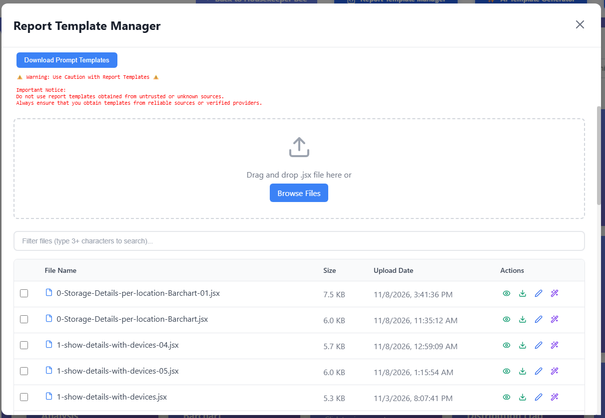

# Introduction
This report server service is designed to empower users to create their own report templates using the default AI from Ollama Cloud or those generated by AI assistants with our prompt templates. Users can utilize the prompt templates available in the "Report Template Manager" to customize their Housekeeper Bee Inventory Management System reports. These prompts guide AI assistants (Claude Desktop Sonnet 4.5, Gemini 3, Poe GPT-4o-Mini, and Ollama::gpt-oss:120b-cloud) in generating a JSX file, which is then deployed to the template folder of the report server through the "Report Template Manager."    

Additionally, the report server allows users to leverage AI to modify existing report templates to create custom ones. Users can easily update visual formatting—such as changing font properties—rearrange layouts by adding, removing, or reordering columns, and modify dynamic elements like hyperlinks.    

<div style="background: linear-gradient(135deg, #1e1b4b 0%, #312e81 100%); color: #ffffff; padding: 24px; border-radius: 12px; box-shadow: 0 4px 15px rgba(0, 0, 0, 0.15); margin: 24px 0;">
  <span style="background-color: #4f46e5; color: #a5b4fc; text-transform: uppercase; font-size: 0.75rem; font-weight: 700; letter-spacing: 0.05em; padding: 4px 8px; border-radius: 4px;">Report Template Engine</span>
  <h3 style="color: #ffffff; margin-top: 10px; margin-bottom: 8px; font-family: system-ui, sans-serif; font-size: 1.4rem; font-weight: 800;">
    ⚡ 100% No-Code Template Customization
  </h3>
  <p style="color: #e0e7ff; margin: 0; font-family: system-ui, sans-serif; font-size: 1.05rem; line-height: 1.6;">
    Create and modify report templates effortlessly using plain, natural language without writing a single line of code. Simply instruct the report server in <span style="color: #67e8f9; font-weight: 600;">English, Cantonese, Traditional Chinese, Japanese, Korean</span>, or any language supported by your selected AI model.
  </p>
</div>


### Disclaimer
This is a proof of concept (PoC) for natural language, no-code report generation.

While the report server includes foundational security checks—such as mitigations for XSS, prompt injection, and cookie-based man-in-the-middle attacks—we strongly advise against using JSX report templates from untrusted sources. Automated security layers cannot guarantee 100% detection of malicious payloads, and you proceed at your own risk when deploying or executing community or third-party templates.

<br>      

# Installation

1. Git clone the housekeeper bee report server to Linux Desktop *(Housekeeper Bee Server Running on Raspberry Pi 5)*
2. Goto `housekeeper-bee-report-server` folder
3. Goto `setup` folder
4. chmod +x *.sh
5. Run the `setup_report_server.sh` file

It will add a startup file to launch the report server when system boot up. And then you need update the .env file under the backend folder. 

# Setup

### Backend Server
1. Go to the **housekeeper-bee-report-server/src/backend/** folder.
```
cd ~/Desktop/housekeeper-bee-report-server/src/backend
```
2. Copy the .env.template to .env file. 
```
cp .env.templete .env
```
2. Edit the .env file. Replace 192.168.50.102 to your ip and replace the Housekeeper Bee API key to your API key.You can follow the YouTube to get the API key (https://youtu.be/x7zshcqJTlY?si=BaizGb1Abd8uhLla). 


<br>
Replace 192.168.50.102 to your IP.   


### Frontend Server
- No configuration is required.


### Linux - Change file wall setting

allow 3801, 3800, 3801 and 5173    

```
sudo ufw allow 3800    
sudo ufw allow 3843    
sudo ufw allow 3801   
sudo ufw allow 5173    
```

<br>

# Requirements
- Housekeeper Bee Inventory Management System (Version 1.7.0 or higher).

<br>

Download 

Housekeeper bee Core Module: 
https://github.com/Thomas-Leung-852/HousekeeperBeeWebApp/archive/refs/heads/main.zip


App update module:
https://github.com/Thomas-Leung-852/HousekeeperBeeWebAppUpdateTool.git


iOS APP from Apple App Store: https://apps.apple.com/us/app/housekeeper-bee/id6742815735


<br>

# How to use the report service

For fresh installation of Housekeeper Bee App, the following code block already exists in the application.properties file.    
For manual update, add the following lines to the Housekeeper Bee application.properties file and then reboot.

Folder: :~/Desktop/housekeeping_bee/files/prog   
File:  application.properties    

Replace 192.168.50.102 to your ip and enable the service  
```
#==================================================
# Apply to vesion 1.7.0
# Connect to external report server service
#==================================================
external.service.report-service.enabled=true
external.service.report-service.url=https://192.168.50.102
external.service.report-service.port=3843
external.service.report-service.secret=${print_server_service_secret}
```


<br>

### Entry point of report server    

 - Log in to the Housekeeper Bee Application. You will find that the report service is enabled. Click the icon to switch to the main screen of the report server.
  


### Report server main page

We have provided several reports for your reference. 





<br>


# How to Use the AI-Enabling Feature

### Video 1: 
This illustrates how to utilize the AI engine provided by Ollama Cloud to generate a report template. The end user only needs to provide a non-technical prompt, and the report template will be created shortly.

[](https://www.youtube.com/watch?v=XKYcv8tCVOw)

### Video 2:
Unlocking the Power of Housekeeper Bee's Report Server    
In this video, we explore how to maximize the potential of Housekeeper Bee's Report Server! While the default AI feature may not meet everyone's needs, did you know that you can customize your reports effortlessly?      

Join us as we walk you through the process of downloading prompts and using sample prompts to tailor your reports to perfection. Whether you're looking for specific data, unique formatting, or specialized content, we’ll demonstrate how easy it is to create exactly what you need.     

Discover the user-friendly tools and techniques that will transform your reporting experience! Don't miss out on this opportunity to elevate your data reporting game with Housekeeper Bee.    

👉 Watch now and see how you can harness the full power of the Report Server!    

[](https://youtu.be/IoI5GKgGCMM?si=UIuhg5sRKuJViSi2)


<br>

# Prompt

Prompts can be find from the ***Docs*** folder.

Sample
```

I want you create a very simple report to analysis my storage boxes usage in table format (column includes - #, location name, box name, barcode, number of item, storage items box status)


A. Create a Housekeeper Bee report as a JSX component in CommonJS format.

B. RAW Data structure (Input data) sample:
{
   storageCode: 'ec93960c4a93ea7c5a58163cd6db6fe2',
   storageName: 'Blue box (cables)',
   storageDesc: 'Micro HDMI x 1, C to 3.5mm USB cable x 1, 3.5mm AUX cable x 1, A to charger USB cable x 1',
   storageRemark: '',
   storageStatus: 'Check-In, 75% occupied',
   barcode: '0250208000047',
   storageCreatedDate: '2025-01-27T16:37:52.810+00:00',
   storageModifiedDate: '2025-08-05T07:02:43.283+00:00',
   locationCode: '2f9c0b9731cff1dd83e4b50386732ba2',
   locationName: 'bedroom',
   locationStatus: 'Full',
   familyName: 'My Dream House',
  tags: [ 'cables', 'hdmi', 'electronics', 'audio' ],
  withNFC: 'no',
  withIBeacon: 'no',
  withBarcode: 'no'
}

C. RULES:
- Add the date and time to the top right corner.
- Storage items include: USB Type-A cable, charger, 5 x USB Type-C cables.
- When grouping reports, use the tag field. Tags should be separated by commas (`,` or `，`).
- For storage items, the notation "N x item" or "item x N" indicates quantity (e.g., "3 x Type-C cable" or "Type-C cable x 3" means the total number of Type-C cables is 3). If no multiplier is specified, it counts as 1 item.
- Example of storage item count: 1 + 1 + 5.
- Total storage item count: 7.
- Finally, replace commas (`,` or `，`) in the storage item field with a line break. Add an asterisk (`*`) before each processed storage item.

D. STYLING RULES:
- Use the "styles" object (will be injected by server)
- Available styles: container, header, subtitle, statCard, cardTotal, cardSuccess, cardWarning, cardDanger, cardInfo, statNumber, statLabel, table, tableHeader, th, td, progressBar, bar, bar100, bar75, bar50, bar25, bar0
- Do NOT define the styles object yourself
- Use inline styles: style={styles.container}
- Combine styles: style={{...styles.statCard, ...styles.cardSuccess}}

E. COMPONENT FORMAT:
- Accept props: { data }
- Export as: module.exports = ComponentName
- Use React.createElement or JSX

Embed the code generated in the JSX component to transform the raw JSON data from the RESTful API into the desired report data structure in JSON format.

For example, you call the MCP server tools to retrieve the raw data from Housekeeper Bee. Then, you use this data to transform it into the required report data structure.

F. IMPORTANT: 
- Please embed the code within a JSX component to handle the data structure transformation.
- Do not use useEffect

```

### Prompt Example: Creating Interactive HTML Storage Reports

```
Generate a storage inventory report as an HTML table with the following columns:

Storage Location – the location where the box is stored
Storage Box Name – the name of the storage box
Total Items – total number of items currently in the storage box
Status – the current status of the storage box
NFC – display Yes if the box has an NFC tag; otherwise 'No'
Barcode – display Yes if the box has a barcode indicator; otherwise 'No'
iBeacon – display Yes if the box has an iBeacon indicator; otherwise 'No'
View – an HTML link that opens the storage box detail page in a new browser tab, using the format:
<a href="https://192.168.50.100:8443/storages/search/storage/storagecode/{STORAGE_BOX_CODE}" target="_blank">View</a>
Replace {STORAGE_BOX_CODE} with the actual storage box code for each row.
Example URL: https://192.168.50.100:8443/storages/search/storage/storagecode/030f734d20cc23165347ecc626e051de
```

#### IMPORTANT
Go to App Settings → Security → iframe sandbox to enable those features.   

<br>

# Manual start the service

Go to ***housekeeper-report-server*** folder    

Command
```     
npm run prod
```
<br>

# Known Issues

After saving the code as a JSX file for deployment, you need to check for issues that may occasionally occur.

1. *const StorageTagAnalysis = ({ data<font color='#0F0'>, styles </font> }) => {*   
   Sometimes, Claude adds styles at line 2. You should manually remove the <font color="#f00">styles</font>.

2. <font color='#0F0'>*export default StorageBoxReport*</font> should be changed to     
   <font color='#f00'>module.exports = StorageBoxReport;</font>


<br>

# What is Housekeeper Bee 


We are excited to introduce our cutting-edge web-based application designed to simplify storage management for families and individuals. As urban living spaces become increasingly compact, our app addresses the rising demand for effective organization and efficient tracking of storage resources. It is fully compatible with desktop browsers and also available as an iOS mobile app, which operates securely on your local home network. This ensures ease of use while maintaining your data's safety and privacy, allowing users to manage their storage effortlessly from anywhere within their home.    
  
The Housekeeper Bee Mobile App seamlessly integrates with our Household Items Management web application, which runs on your on-premise Raspberry Pi 5 (4GB) server.

Household Items Management Features:   
- Track Assets: Keep a detailed record of items stored in various locations, ensuring you always know where everything is.    
- AI Functionality: Leverage advanced features such as the MCP server and a Telegram-based AI agent.
- Our application enables you to monitor environmental temperature and humidity, effectively protecting your stored items in storage boxes. It proactively sends alert messages when preset thresholds are met. You can use natural language to instruct the AI assistant to make decisions regarding the control of dehumidifiers and fan.    
- Custom Reporting: Our newly developed report server empowers users to generate customized reports based on specific prompts. With the capabilities of the Claude Desktop AI assistant, creating your favorite report has never been easier.   
  
Ready to take control of your storage solutions? Download the app today and experience the convenience for yourself! For more information, visit our website. Please check out my GitHub repository: https://github.com/Thomas-Leung-852.


